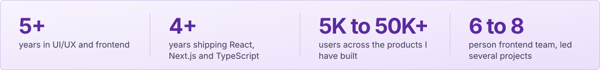
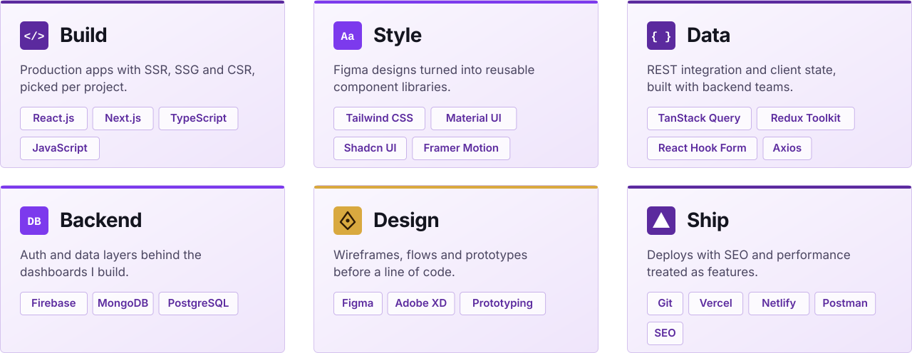
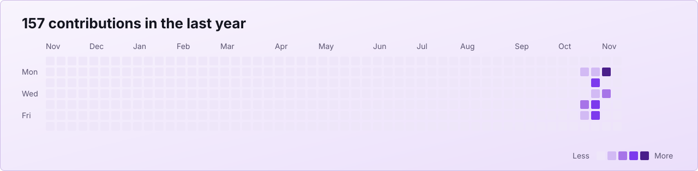

  

  Kota, India &nbsp;|&nbsp; Open to product teams, remote or on-sit  
  <a href="https://portfolio-itisamit.vercel.app/">Portfolio</a> &nbsp;·&nbsp;
  <a href="https://www.linkedin.com/in/amit-verma-2a46971b4/">LinkedIn</a> &nbsp;·&nbsp;
  <a href="mailto:amverma1204t@gmail.com">Email</a> &nbsp;·&nbsp;
  <a href="https://ik.imagekit.io/g947cuvcp/Amit_Verma_Frontend_Developer.pdf">Resume</a>

  

## Currently

Building Next.js products at **Kriscent Techno Hub**, from fleet dashboards to social and commerce platforms. Looking for a product team that cares about design quality and ships often.

## What I build

| Dashboards and admin tools | Public sites and marketplaces | Design-heavy product UI |
| :-- | :-- | :-- |
| Fleet management, industrial wastewater monitoring, school administration. | SEO-first websites, a textile marketplace pilot, company sites on static hosting. | Social, e-commerce and AI-astrology products on reusable component systems. |

## Skills

  

## Stack mix

  

## Path

  

## Contribution calendar

  

Most of my recent work lives in private company repositories, so the calendar understates it.

## Contact

[amverma1204t@gmail.com](mailto:amverma1204t@gmail.com) · [LinkedIn](https://www.linkedin.com/in/amit-verma-2a46971b4/) · [Portfolio](https://portfolio-itisamit.vercel.app/) · [GitHub](https://github.com/it-is-amit)
