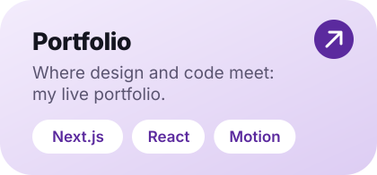
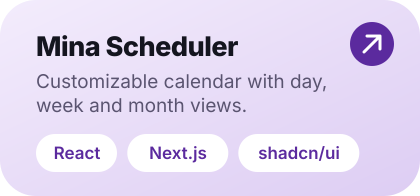
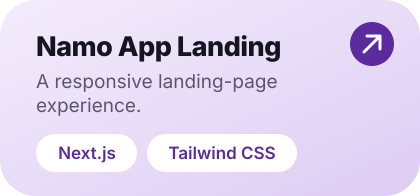
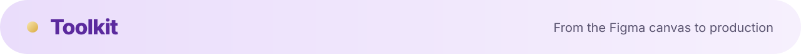
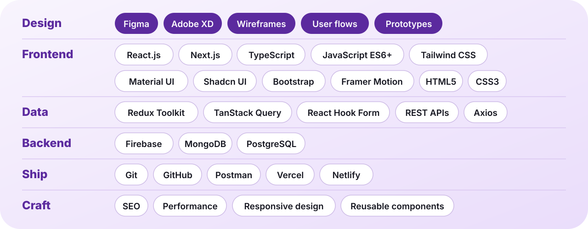
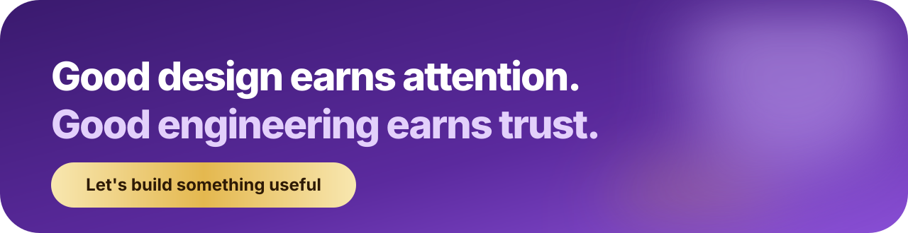

  

  
  
  
  
  

  

 

  

  
  
  
  
  
  

  Fleet management, social media, e-commerce, AI astrology, industrial monitoring and education platforms, built with teams.

 

  

  
  
  

 

  
    
  

 

  
    
  

 

  
    
  <picture>
    <source media="(prefers-color-scheme: dark)" srcset="https://github-readme-activity-graph.vercel.app/graph?username=it-is-amit&bg_color=14151F&color=D9C4F5&line=B78CEF&point=FFFFFF&area=true&area_color=7C3AED&hide_border=true" />
    
  </picture>

 

  
    
  Designed in Figma. Built in React. Open to Senior Frontend roles in India and remote.

